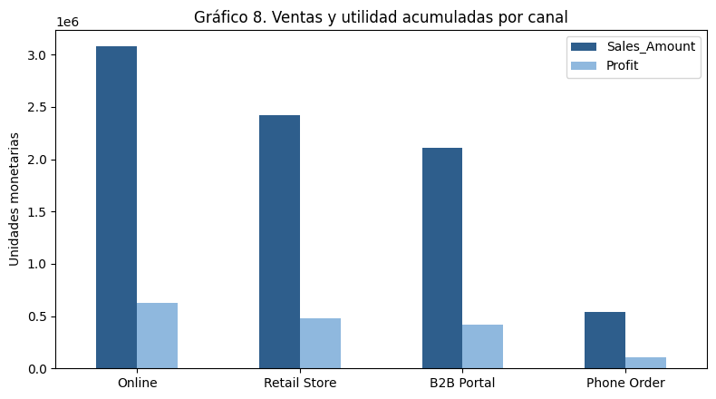
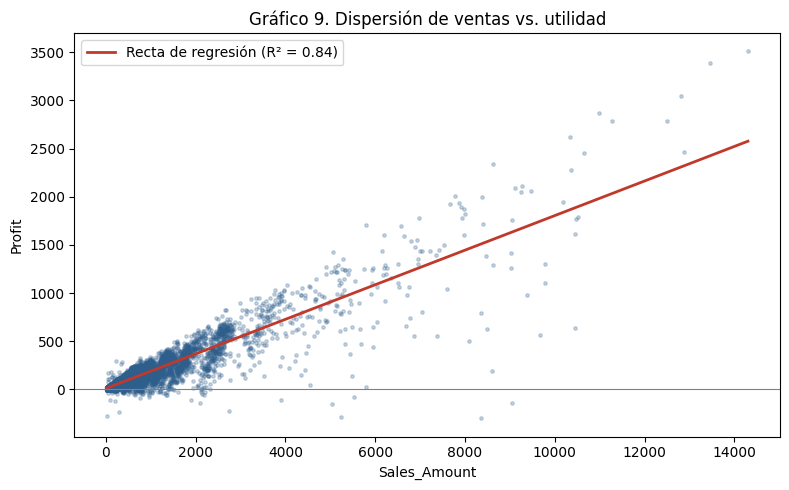

Análisis descriptivo de 17.830 transacciones de ventas
> ¿Qué canales y categorías generan más ventas y utilidad, y qué tan fuerte es la relación entre el monto vendido y la utilidad?
Análisis estadístico descriptivo en Python sobre un conjunto de transacciones de venta (datos sintéticos de Kaggle). Incluye limpieza de datos, análisis univariado y bivariado, detección de valores atípicos y medidas descriptivas.
Hallazgo principal: cerca del 10% de las transacciones (las de mayor valor) concentra el 51% de las ventas y el 46% de la utilidad, y el margen es casi igual en todos los canales (≈20%): lo que mueve la utilidad es el volumen, no la rentabilidad.
---
Contenido
Contexto
Datos
Limpieza de datos
Metodología
Hallazgos clave
Limitaciones
Estructura del repositorio
Cómo reproducirlo
Autor
Referencias
---
Contexto
Las empresas venden por múltiples canales y entender cuáles generan más ingresos y utilidad es clave para asignar recursos. Este proyecto resume miles de transacciones con tablas de frecuencia, medidas de tendencia central y de dispersión, y detecta valores atípicos que distorsionan los promedios.
Trabajo realizado en la asignatura Análisis Estadístico de Información de la Especialización en Finanzas, Fundación Universitaria Compensar (2026).
Datos
Fuente: Retail Sales Dataset (Daniel Sowah), Kaggle.
Naturaleza: datos sintéticos con fines educativos. Los resultados describen el comportamiento de la base, no el de un mercado real.
Tamaño original: 18.045 registros y 36 variables.
Tamaño tras la limpieza: 17.830 registros (98,8% de la base original).
Variables seleccionadas
Variable	Descripción	Tipo	Escala
`Sales_Channel`	Canal de venta (Online, Retail Store, B2B Portal, Phone Order)	Cualitativa	Nominal
`Product_Category`	Categoría del producto (Electronics, Office Supplies, Furniture, Appliances)	Cualitativa	Nominal
`Quantity`	Unidades vendidas por transacción (1 a 11)	Cuantitativa discreta	Razón
`Delivery_Days`	Días hasta la entrega (0 a 10)	Cuantitativa discreta	Razón
`Sales_Amount`	Monto neto de la venta	Cuantitativa continua	Razón
`Profit`	Utilidad de la transacción	Cuantitativa continua	Razón
La moneda de los montos no está especificada en la base, por eso se habla de "unidades monetarias".
Limpieza de datos
Paso	Problema	Acción	Registros resultantes
Base original			18.045
Duplicados	45 registros repetidos	Eliminados	18.000
Cantidades inválidas	8 transacciones con cantidad ≤ 0	Eliminadas	17.992
Valores faltantes	162 nulos en `Delivery_Days`	Eliminados	17.830
Otras decisiones:
Texto inconsistente: variantes como `electronics`, `FURNITURE` u `Office supplies` se unificaron en `Electronics`, `Furniture` y `Office Supplies`.
Coherencia de la utilidad: se verificó que fuera igual a venta menos costo. Las diferencias fueron en su mayoría de redondeo (≈0,01) y las mayores a una unidad monetaria representaron menos del 1% de los registros, por lo que se conservaron.
Valores extremos: no se eliminaron, porque son transacciones válidas y su estudio es parte del objetivo. Se identifican con el criterio del rango intercuartílico (IQR).
Metodología
Análisis univariado: tablas de frecuencia y gráficos para las variables cualitativas; histogramas y diagramas de caja para las cuantitativas.
Análisis bivariado:
Dos variables cualitativas (canal y categoría): tabla de contingencia, prueba de independencia chi-cuadrado y V de Cramér.
Dos variables cuantitativas (ventas y utilidad): correlación de Pearson y Spearman, y regresión lineal simple.
Medidas descriptivas: media, mediana, moda, cuartiles, rango, varianza, desviación estándar, coeficiente de variación, asimetría y curtosis.
Valores atípicos: criterio del rango intercuartílico.
Hallazgos clave
1. Dónde se concentran las transacciones
Canal	Transacciones	%
Online	8.115	45,51%
Retail Store	6.168	34,59%
B2B Portal	2.111	11,84%
Phone Order	1.436	8,05%
Online y Retail Store reúnen el 80,11% de las transacciones. Por categoría, Electronics concentra el 45,54%.
2. Ventas y utilidad por canal
Canal	Ventas	Utilidad	Margen	% de las ventas
Online	3.082.494	623.478	20,23%	37,82%
Retail Store	2.417.960	481.769	19,92%	29,66%
B2B Portal	2.108.631	416.828	19,77%	25,87%
Phone Order	541.720	106.737	19,70%	6,65%
El margen es casi idéntico (19,70% a 20,23%): ningún canal es más rentable en proporción; la diferencia está en el volumen.
B2B Portal tiene solo el 11,84% de las transacciones pero aporta el 25,87% de las ventas, porque su venta promedio (≈999) es unas 2,6 veces la de los demás canales.
3. Ventas y utilidad por categoría
Categoría	% de las ventas	Margen
Electronics	59,94%	19,34%
Furniture	24,03%	21,16%
Office Supplies	8,95%	19,52%
Appliances	7,08%	22,03%
Electronics concentra casi el 60% de las ventas con el menor margen; Appliances tiene el mejor margen pero solo el 7,08% de las ventas.
4. La categoría comprada no depende del canal
Prueba chi-cuadrado: χ² = 7,20, 9 grados de libertad, p = 0,6168. V de Cramér = 0,0116. No hay evidencia de asociación entre canal y categoría: la mezcla de productos es casi idéntica en los cuatro canales.
5. Relación entre ventas y utilidad
Correlación de Pearson: 0,9174; Spearman: 0,8868 (ambas con p < 0,001).
Recta de regresión: `Profit = 9,28 + 0,1795 × Sales_Amount`, con R² = 0,8412.
Por cada unidad monetaria adicional de venta, la utilidad aumenta en promedio 0,18. Las ventas explican cerca del 84% de la variación de la utilidad.
La relación pierde precisión en ventas altas, donde aparecen transacciones con pérdida.
6. El promedio engaña
Medida	Ventas	Utilidad
Media	457,14	91,35
Mediana	168,68	40,17
Coeficiente de variación	187,69%	183,82%
Asimetría	5,74	6,63
La media es unas 2,7 veces la mediana en ventas: unas pocas transacciones muy grandes inflan el promedio. La transacción típica es pequeña (1 o 2 unidades, ≈169 de venta, ≈40 de utilidad).
7. Concentración en pocas transacciones
Alrededor del 10% de las transacciones (9,92%), las de mayor valor, concentra el 51,22% de las ventas y el 46,45% de la utilidad. Con el criterio del IQR hay 1.768 ventas atípicas (9,9%, por encima de 1.061) y 1.850 utilidades atípicas (10,4%).
Gráficos


Limitaciones
Los datos son sintéticos; las conclusiones describen la base y no un mercado real.
La moneda de los montos no está especificada.
Es estadística descriptiva: muestra asociaciones, pero no establece causalidad.
La interpretación de las entregas de 0 días como compras en tienda es una hipótesis, no un dato de la base.
Estructura del repositorio
```
ventas-analisis-descriptivo/
├── README.md
├── requirements.txt
├── data/                 # enlace de descarga del dataset (no se sube el archivo)
├── notebooks/            # código del análisis
├── outputs/              # gráficos y tablas generados
└── informe/              # informe completo en PDF
```
## Cómo reproducirlo

El análisis está escrito para Google Colab.

1. Descarga el dataset desde [Kaggle](https://www.kaggle.com/datasets/danielsowah123/retail-sales-dataset). El archivo usado es `Sales_transactions_2022_2025.csv`.
2. Abre el notebook en [Google Colab](https://colab.research.google.com) (menú Archivo → Subir cuaderno).
3. Ejecuta la primera celda y, cuando lo pida, selecciona el archivo CSV.
4. Ejecuta el resto de las celdas en orden.
   ```
Herramientas: Python (pandas, numpy, matplotlib, scipy).
Autor
Juan Pablo Mulett Vergara: economista, especialización en Finanzas en curso (Fundación Universitaria Compensar).
Contacto: juanpmulettv@gmail.com
Referencias
Devore, J. L. (2021). Probabilidad y estadística para ingeniería y ciencias (9.ª ed.). Cengage Learning.
Kotler, P., & Keller, K. L. (2016). Marketing management (15.ª ed.). Pearson.
Verhoef, P. C., Kannan, P. K., & Inman, J. J. (2015). From multi-channel retailing to omni-channel retailing. Journal of Retailing, 91(2), 174-181.
Sowah, D. (2026). Retail Sales Dataset. Kaggle. https://www.kaggle.com/datasets/danielsowah123/retail-sales-dataset
